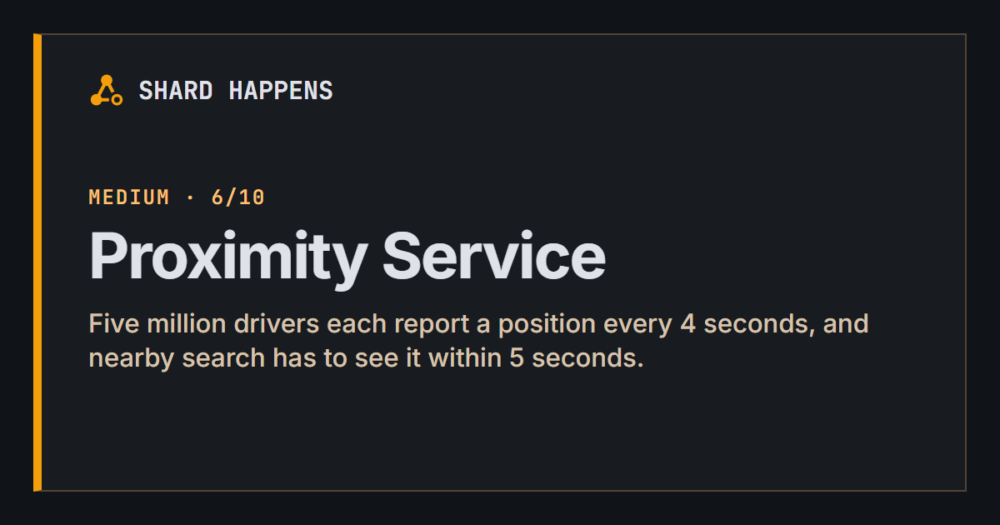

# 2. Proximity Service

> Five million drivers each report a position every 4 seconds, and nearby search has to see it within 5 seconds.

The Real-Time Challenge (Yelp nearby search, Uber "drivers near me"). Tests spatial indexing and how to absorb location data that changes every few seconds.

| Level | Score | Data modelling | Scale | Consistency | Real-time | Algorithmic depth |
|---|---|---|---|---|---|---|
| Medium | 6/10 | 3/5 | 4/5 | 1/5 | 4/5 | 4/5 |

The introduction, the difficulty breakdown, the problem framing and the questions are open to everyone. The rest of the page needs premium access.

**[Read it on shardhappens.dev](https://shardhappens.dev/problems/proximity-service/)**

[All problems](../README.md)
