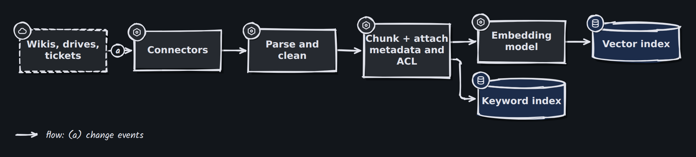

# 13. RAG Knowledge Assistant

> The assistant answered correctly and cited its source, a document the user had no permission to read.

The Grounding Challenge ("chat with your company documents", support assistants). AI architecture: tests whether the candidate can make a language model answer from private, changing data, with sources, without leaking documents the user may not see.

| Level | Score | Data modelling | Scale | Consistency | Real-time | Algorithmic depth |
|---|---|---|---|---|---|---|
| Medium · AI | 5/10 | 3/5 | 3/5 | 2/5 | 3/5 | 4/5 |

## What the interviewer looks for

| Green flags | Red flags |
|---|---|
| Explains why retrieval beats fine-tuning for changing facts | "Fine-tune it on our docs" |
| Designs ingestion and query as separate pipelines | Only draws the query path |
| Enforces permissions at retrieval | Filters the final answer, or ignores permissions |
| Adds keyword search and reranking, and can say why | Treats the vector database as the whole solution |
| Has a plan to measure quality | "We will try it and see" |
| Treats documents as untrusted input | Unaware of prompt injection |

The page is free to read in full: the questions an interviewer asks, the approaches compared, the whole design and the numbers behind it.

**[Read it on shardhappens.dev](https://shardhappens.dev/problems/rag-knowledge-assistant/)**

[All problems](../README.md)
