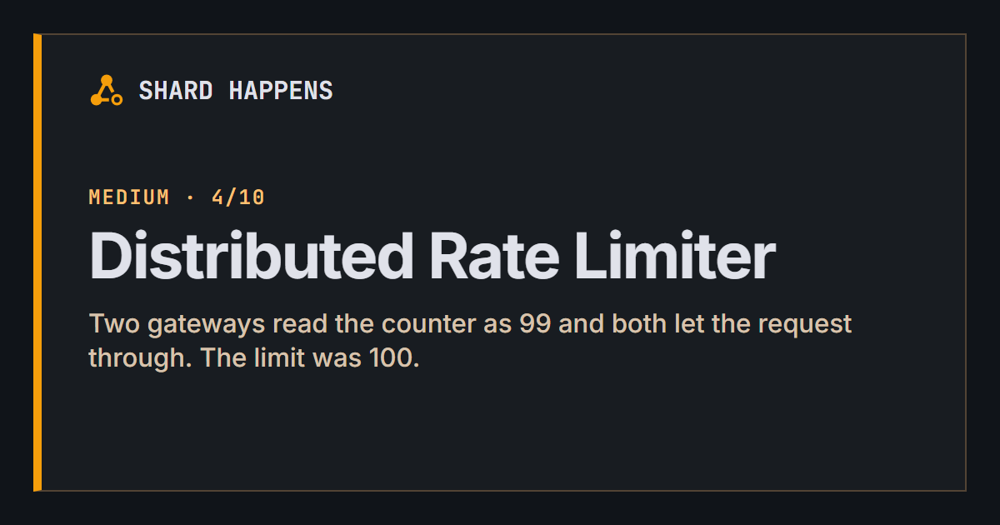

# 5. Distributed Rate Limiter

> Two gateways read the counter as 99 and both let the request through. The limit was 100.

The Traffic Control Challenge (API gateway throttling, Stripe or GitHub API limits). Added to the set: small surface, but exposes whether the candidate understands atomicity, race conditions and failure policy.

| Level | Score | Data modelling | Scale | Consistency | Real-time | Algorithmic depth |
|---|---|---|---|---|---|---|
| Medium | 4/10 | 1/5 | 3/5 | 3/5 | 2/5 | 3/5 |

The introduction, the difficulty breakdown, the problem framing and the questions are open to everyone. The rest of the page needs premium access.

**[Read it on shardhappens.dev](https://shardhappens.dev/problems/rate-limiter/)**

[All problems](../README.md)
