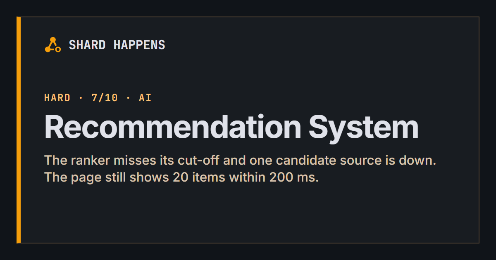

# 37. Recommendation System

> The ranker misses its cut-off and one candidate source is down. The page still shows 20 items within 200 ms.

The Deadline Challenge (YouTube home page, Instagram Explore). AI serving: choose what to show one user from 100 million items in 200 ms, through retrieval, filtering, ranking and re-ranking, and degrade to something useful when a stage is late or down.

| Level | Score | Data modelling | Scale | Consistency | Real-time | Algorithmic depth |
|---|---|---|---|---|---|---|
| Hard · AI | 7/10 | 2/5 | 4/5 | 2/5 | 4/5 | 3/5 |

The introduction, the difficulty breakdown, the problem framing and the questions are open to everyone. The rest of the page needs premium access.

**[Read it on shardhappens.dev](https://shardhappens.dev/problems/recommendation-serving/)**

[All problems](../README.md)
