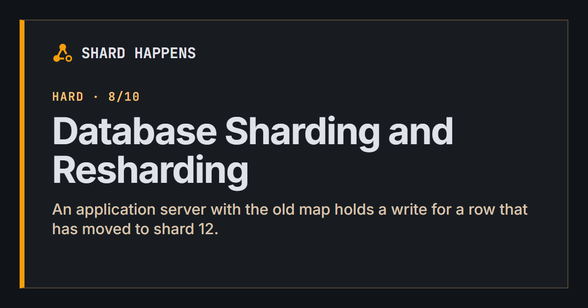

# 65. Database Sharding and Resharding

> An application server with the old map holds a write for a row that has moved to shard 12.

The Split Challenge (Vitess, Citus). Splitting a 3 TB shard that takes 4,000 writes a second onto a new database, with one switch of write ownership and an application server holding the old map refused rather than obeyed.

| Level | Score | Data modelling | Scale | Consistency | Real-time | Algorithmic depth |
|---|---|---|---|---|---|---|
| Hard | 8/10 | 3/5 | 4/5 | 5/5 | 2/5 | 3/5 |

The introduction, the difficulty breakdown, the problem framing and the questions are open to everyone. The rest of the page needs premium access.

**[Read it on shardhappens.dev](https://shardhappens.dev/problems/resharding/)**

[All problems](../README.md)
