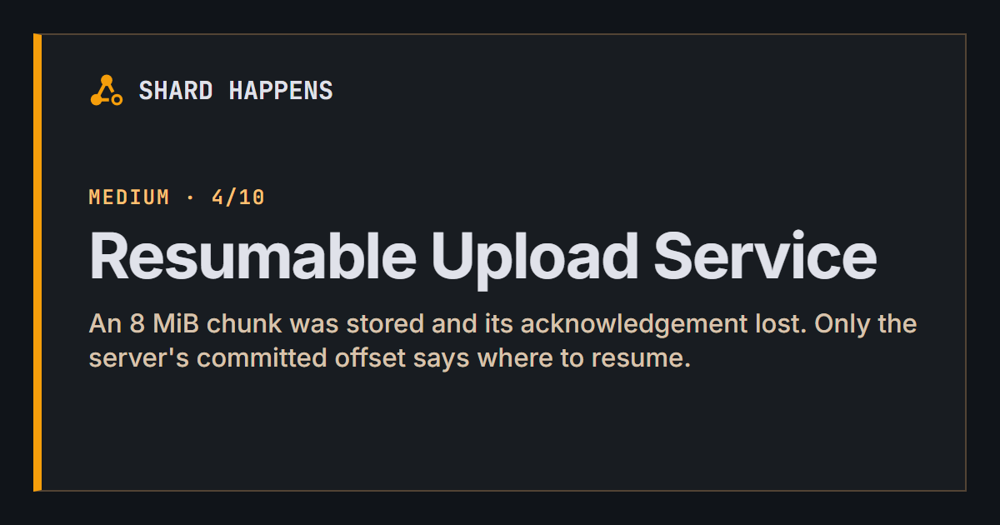

# 23. Resumable Upload Service

> An 8 MiB chunk was stored and its acknowledgement lost. Only the server's committed offset says where to resume.

The Lost Acknowledgement Challenge (the tus protocol, resumable uploads in the Google Drive API). Upload one large file over a connection that drops, resume from the offset the server has durably committed, and check that the finished file is the one the user sent.

| Level | Score | Data modelling | Scale | Consistency | Real-time | Algorithmic depth |
|---|---|---|---|---|---|---|
| Medium | 4/10 | 2/5 | 2/5 | 3/5 | 1/5 | 2/5 |

The introduction, the difficulty breakdown, the problem framing and the questions are open to everyone. The rest of the page needs a free account.

**[Read it on shardhappens.dev](https://shardhappens.dev/problems/resumable-upload-service/)**

[All problems](../README.md)
