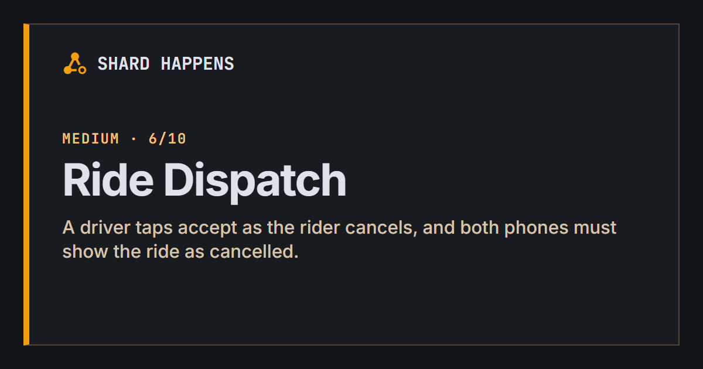

# 71. Ride Dispatch

> A driver taps accept as the rider cancels, and both phones must show the ride as cancelled.

The Assignment Challenge (Uber, Lyft). Tests a one-to-one assignment between riders and drivers who each act on their own phone, with offers that can be declined, ignored or cancelled mid-flight.

| Level | Score | Data modelling | Scale | Consistency | Real-time | Algorithmic depth |
|---|---|---|---|---|---|---|
| Medium | 6/10 | 3/5 | 2/5 | 4/5 | 4/5 | 3/5 |

The introduction, the difficulty breakdown, the problem framing and the questions are open to everyone. The rest of the page needs a free account.

**[Read it on shardhappens.dev](https://shardhappens.dev/problems/ride-dispatch/)**

[All problems](../README.md)
