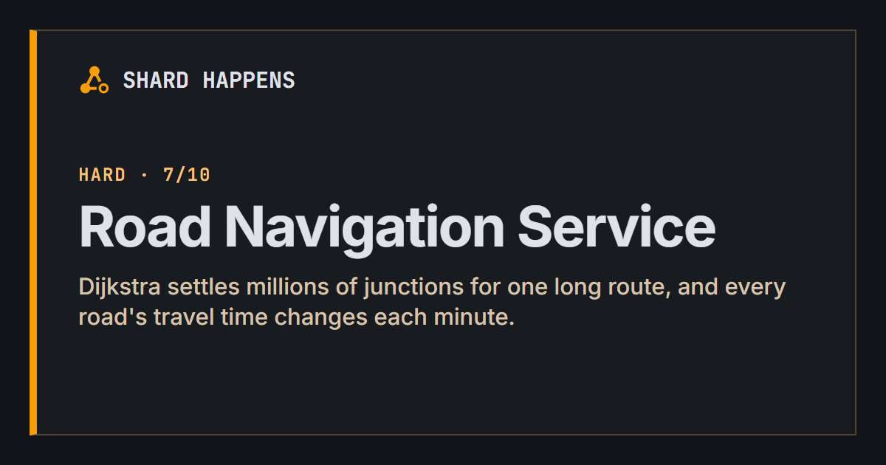

# 59. Road Navigation Service

> Dijkstra settles millions of junctions for one long route, and every road's travel time changes each minute.

The Fastest-Route Challenge (Google Maps, Waze). Fastest routes on a road graph of 50 million junctions in milliseconds, while every road's travel time changes each minute: why Dijkstra and A* are too slow, precomputed shortcuts that survive new travel times, live traffic, arrival times and re-routing.

| Level | Score | Data modelling | Scale | Consistency | Real-time | Algorithmic depth |
|---|---|---|---|---|---|---|
| Hard | 7/10 | 3/5 | 4/5 | 2/5 | 4/5 | 5/5 |

The introduction, the difficulty breakdown, the problem framing and the questions are open to everyone. The rest of the page needs premium access.

**[Read it on shardhappens.dev](https://shardhappens.dev/problems/road-navigation/)**

[All problems](../README.md)
