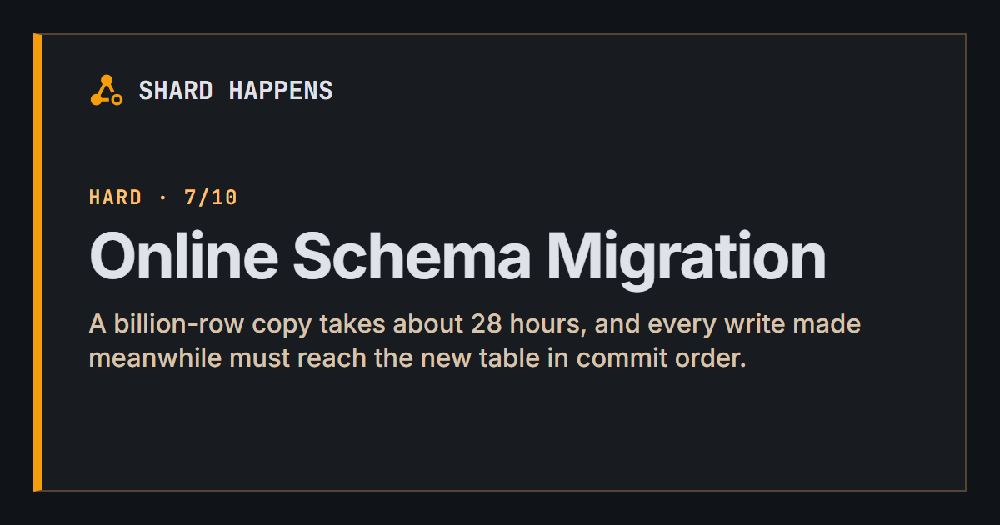

# 60. Online Schema Migration

> A billion-row copy takes about 28 hours, and every write made meanwhile must reach the new table in commit order.

The Cut-Over Challenge (gh-ost, pt-online-schema-change). Changing a column's type on a billion-row MySQL table that takes thousands of writes a second, without blocking them for more than a moment or losing one.

| Level | Score | Data modelling | Scale | Consistency | Real-time | Algorithmic depth |
|---|---|---|---|---|---|---|
| Hard | 7/10 | 2/5 | 3/5 | 5/5 | 2/5 | 3/5 |

The introduction, the difficulty breakdown, the problem framing and the questions are open to everyone. The rest of the page needs premium access.

**[Read it on shardhappens.dev](https://shardhappens.dev/problems/schema-migration/)**

[All problems](../README.md)
