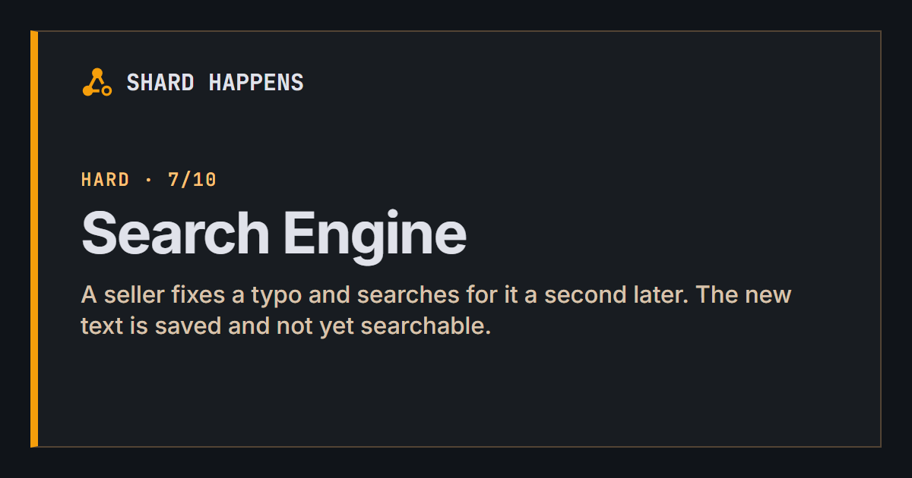

# 38. Search Engine

> A seller fixes a typo and searches for it a second later. The new text is saved and not yet searchable.

The Freshness Challenge (Elasticsearch on Apache Lucene, the search box of a marketplace, forum or help desk). A billion changing documents in a sharded inverted index, and the trade between how soon an edit is searchable and what every query pays for it.

| Level | Score | Data modelling | Scale | Consistency | Real-time | Algorithmic depth |
|---|---|---|---|---|---|---|
| Hard | 7/10 | 3/5 | 4/5 | 3/5 | 3/5 | 4/5 |

The introduction, the difficulty breakdown, the problem framing and the questions are open to everyone. The rest of the page needs premium access.

**[Read it on shardhappens.dev](https://shardhappens.dev/problems/search-engine/)**

[All problems](../README.md)
