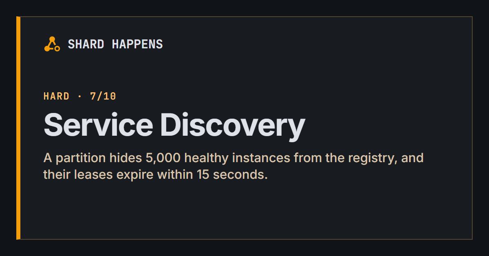

# 69. Service Discovery

> A partition hides 5,000 healthy instances from the registry, and their leases expire within 15 seconds.

The Membership Challenge (Consul, Netflix Eureka, Kubernetes EndpointSlices). Every caller keeps a fresh list of healthy addresses for the services it calls, without asking a registry per request and without the registry's failure stopping traffic.

| Level | Score | Data modelling | Scale | Consistency | Real-time | Algorithmic depth |
|---|---|---|---|---|---|---|
| Hard | 7/10 | 2/5 | 3/5 | 4/5 | 3/5 | 3/5 |

The introduction, the difficulty breakdown, the problem framing and the questions are open to everyone. The rest of the page needs premium access.

**[Read it on shardhappens.dev](https://shardhappens.dev/problems/service-discovery/)**

[All problems](../README.md)
