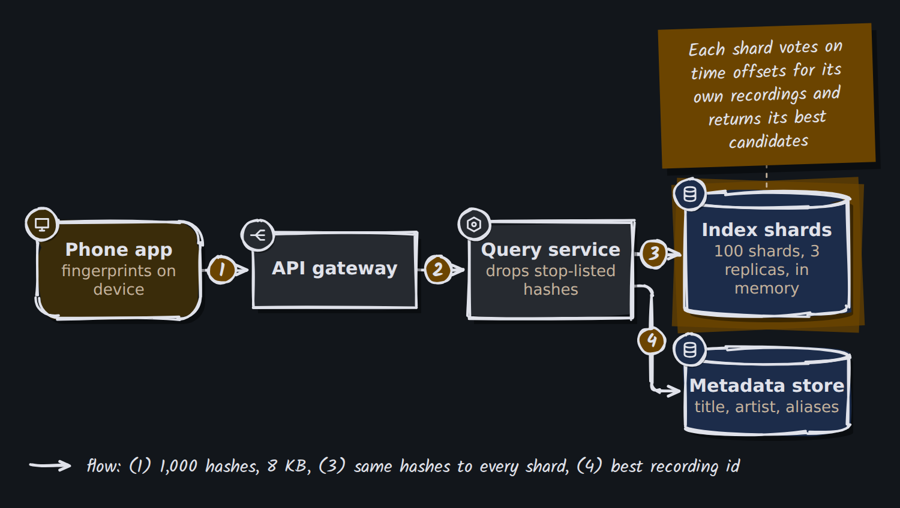

# 77. Song Recognition

> A 10-second clip's hashes hit hundreds of thousands of recordings. The match is the one whose hits agree on one offset.

The Fingerprint Challenge (Shazam, broadcast monitoring). Name one recording among 100 million from a noisy 10-second clip that starts anywhere in the track, with peak-pair hashes, bounded posting-list work and votes on the time offset.

| Level | Score | Data modelling | Scale | Consistency | Real-time | Algorithmic depth |
|---|---|---|---|---|---|---|
| Hard | 7/10 | 2/5 | 4/5 | 2/5 | 3/5 | 5/5 |

## What the interviewer looks for

| Green flags | Red flags |
|---|---|
| Scores a candidate by hits agreeing on one time offset | Ranks recordings by the number of matching hashes |
| Computes postings per query as hashes × list length and bounds popular hashes | "It is a hash lookup, so it is O(1)" |
| Shards by recording so votes stay local, and states the fan-out cost | Shards by hash without counting the postings shipped to be voted on |
| Sets the threshold from the scores of wrong matches and a false-positive rate | A fixed hit count with no false-positive reasoning |
| States what the fingerprint is not invariant to: tempo, pitch, live performance | Presents a 2003 paper as Shazam's current production system |

The page is free to read in full: the questions an interviewer asks, the approaches compared, the whole design and the numbers behind it.

**[Read it on shardhappens.dev](https://shardhappens.dev/problems/song-recognition/)**

[All problems](../README.md)
