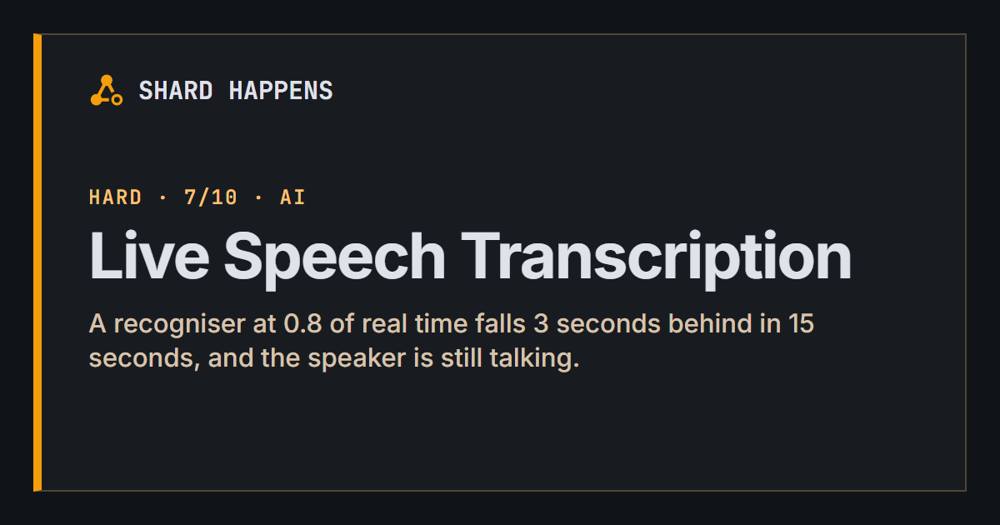

# 55. Live Speech Transcription

> A recogniser at 0.8 of real time falls 3 seconds behind in 15 seconds, and the speaker is still talking.

The Live Captions Challenge (live captions in a meeting product, a streaming speech-to-text API). AI architecture: audio that cannot be paused, a recogniser on GPUs that is sometimes slower than real time, and a listener who expects words within a second, revised and then fixed.

| Level | Score | Data modelling | Scale | Consistency | Real-time | Algorithmic depth |
|---|---|---|---|---|---|---|
| Hard · AI | 7/10 | 2/5 | 3/5 | 3/5 | 5/5 | 3/5 |

The introduction, the difficulty breakdown, the problem framing and the questions are open to everyone. The rest of the page needs premium access.

**[Read it on shardhappens.dev](https://shardhappens.dev/problems/speech-transcription/)**

[All problems](../README.md)
