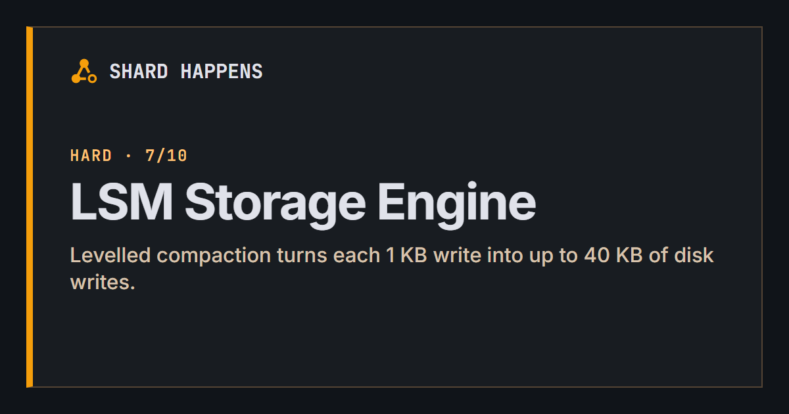

# 58. LSM Storage Engine

> Levelled compaction turns each 1 KB write into up to 40 KB of disk writes.

The Compaction Challenge (LevelDB, RocksDB). A single-node log-structured key-value engine: the write-ahead log and its sync policy, memtable flushes, reads through Bloom filters, levelled against size-tiered compaction with write, read and space amplification computed from stated sizes, tombstones, crash recovery and write stalls.

| Level | Score | Data modelling | Scale | Consistency | Real-time | Algorithmic depth |
|---|---|---|---|---|---|---|
| Hard | 7/10 | 2/5 | 2/5 | 4/5 | 2/5 | 4/5 |

The introduction, the difficulty breakdown, the problem framing and the questions are open to everyone. The rest of the page needs premium access.

**[Read it on shardhappens.dev](https://shardhappens.dev/problems/storage-engine/)**

[All problems](../README.md)
