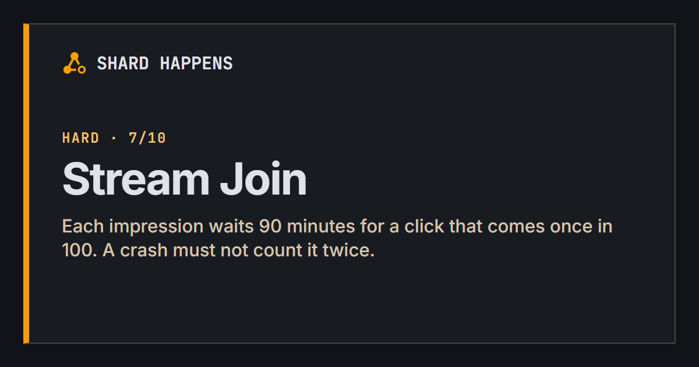

# 62. Stream Join

> Each impression waits 90 minutes for a click that comes once in 100. A crash must not count it twice.

The Stream Join Challenge (ad click attribution on Apache Flink or Kafka Streams). Joining two unbounded streams whose matching events arrive minutes apart and out of order, without losing a match or counting one twice.

| Level | Score | Data modelling | Scale | Consistency | Real-time | Algorithmic depth |
|---|---|---|---|---|---|---|
| Hard | 7/10 | 2/5 | 4/5 | 5/5 | 4/5 | 3/5 |

The introduction, the difficulty breakdown, the problem framing and the questions are open to everyone. The rest of the page needs premium access.

**[Read it on shardhappens.dev](https://shardhappens.dev/problems/stream-join/)**

[All problems](../README.md)
