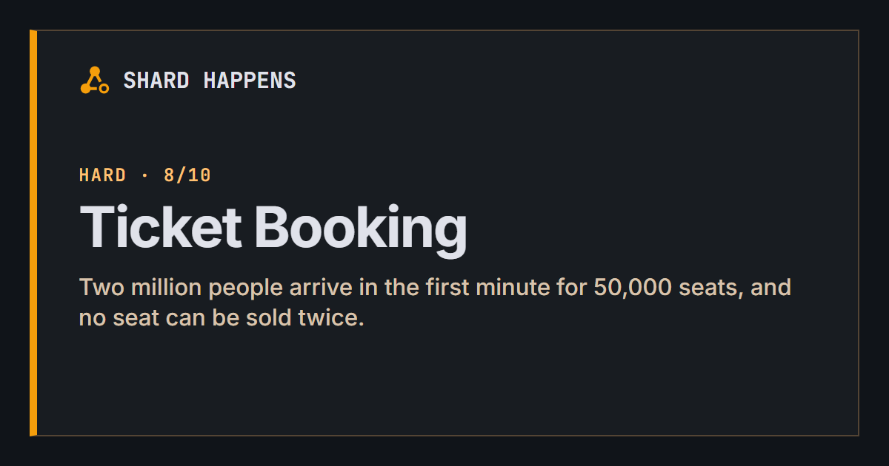

# 3. Ticket Booking

> Two million people arrive in the first minute for 50,000 seats, and no seat can be sold twice.

The Consistency Challenge (Ticketmaster, airline reservations). The test of transactional correctness while a thundering herd hits "Buy" in the same millisecond.

| Level | Score | Data modelling | Scale | Consistency | Real-time | Algorithmic depth |
|---|---|---|---|---|---|---|
| Hard | 8/10 | 4/5 | 4/5 | 5/5 | 3/5 | 3/5 |

The introduction, the difficulty breakdown, the problem framing and the questions are open to everyone. The rest of the page needs premium access.

**[Read it on shardhappens.dev](https://shardhappens.dev/problems/ticket-booking/)**

[All problems](../README.md)
