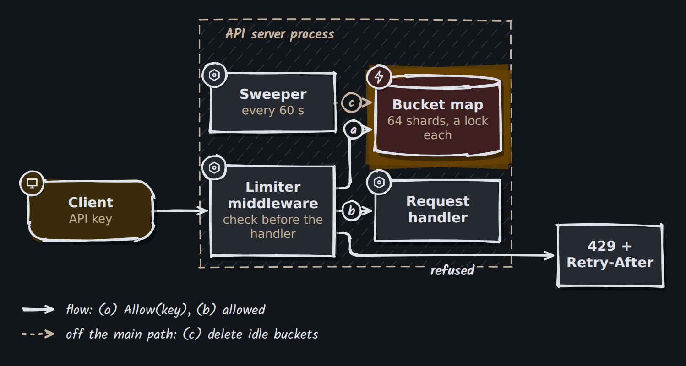

# 31. Token Bucket Rate Limiter

> A limit of 100 a minute, counted in fixed windows, accepts 100 requests at 0:59 and 100 more at 1:00.

The Burst Challenge (per-client limits inside one API server or one gateway instance). What "100 requests a minute" lets a client do under four algorithms, a token bucket held in memory with a monotonic clock and one critical section per check, and what the client is told when it is refused.

| Level | Score | Data modelling | Scale | Consistency | Real-time | Algorithmic depth |
|---|---|---|---|---|---|---|
| Easy | 3/10 | 1/5 | 1/5 | 2/5 | 2/5 | 3/5 |

## What the interviewer looks for

| Green flags | Red flags |
|---|---|
| Asks what "100 a minute" must guarantee before choosing an algorithm | Chooses an algorithm without saying what the limit allows |
| Computes the boundary burst and each algorithm's worst case | Calls one algorithm the best with no arithmetic |
| Refills lazily from a timestamp on a monotonic clock | A timer per client, or elapsed time from the wall clock |
| Puts the clock read, refill, comparison and deduction in one critical section and says why | Reads the tokens, then deducts them in a separate step |
| Evicts idle buckets and states the restart and one-process limits | A map that only grows, or a claim that the limit holds behind a load balancer |

The page is free to read in full: the questions an interviewer asks, the approaches compared, the whole design and the numbers behind it.

**[Read it on shardhappens.dev](https://shardhappens.dev/problems/token-bucket-rate-limiter/)**

[All problems](../README.md)
