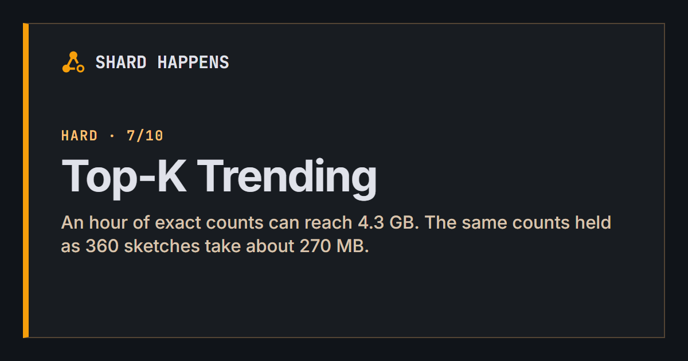

# 4. Top-K Trending

> An hour of exact counts can reach 4.3 GB. The same counts held as 360 sketches take about 270 MB.

The Data Stream Challenge (X trending topics). Tests real-time aggregation over an unbounded stream, and whether the candidate knows when approximate is good enough.

| Level | Score | Data modelling | Scale | Consistency | Real-time | Algorithmic depth |
|---|---|---|---|---|---|---|
| Hard | 7/10 | 2/5 | 4/5 | 2/5 | 4/5 | 5/5 |

The introduction, the difficulty breakdown, the problem framing and the questions are open to everyone. The rest of the page needs premium access.

**[Read it on shardhappens.dev](https://shardhappens.dev/problems/top-k-trending/)**

[All problems](../README.md)
