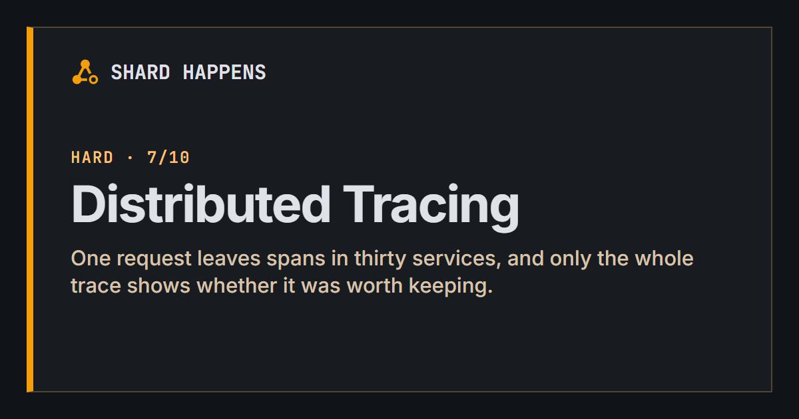

# 52. Distributed Tracing

> One request leaves spans in thirty services, and only the whole trace shows whether it was worth keeping.

The Late Span Challenge (Jaeger, Zipkin, OpenTelemetry, Google's Dapper). Tests whether a tracing pipeline can keep the failed and slow traces, which are only recognisable once every span has arrived, without storing everything, waiting forever or holding unbounded spans in memory.

| Level | Score | Data modelling | Scale | Consistency | Real-time | Algorithmic depth |
|---|---|---|---|---|---|---|
| Hard | 7/10 | 3/5 | 5/5 | 3/5 | 3/5 | 3/5 |

The introduction, the difficulty breakdown, the problem framing and the questions are open to everyone. The rest of the page needs premium access.

**[Read it on shardhappens.dev](https://shardhappens.dev/problems/trace-collection/)**

[All problems](../README.md)
