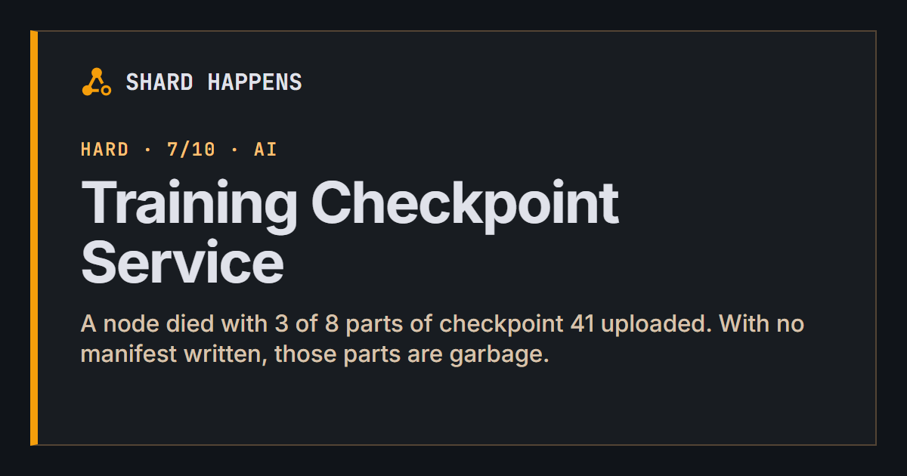

# 64. Training Checkpoint Service

> A node died with 3 of 8 parts of checkpoint 41 uploaded. With no manifest written, those parts are garbage.

The Coherent Checkpoint Challenge (asynchronous distributed checkpointing in PyTorch, checkpoints on an object store). AI infrastructure: saving the state of a 512-GPU training job so that every part belongs to one step and reached durable storage, without leaving the GPUs idle while it is written.

| Level | Score | Data modelling | Scale | Consistency | Real-time | Algorithmic depth |
|---|---|---|---|---|---|---|
| Hard · AI | 7/10 | 2/5 | 3/5 | 4/5 | 2/5 | 3/5 |

The introduction, the difficulty breakdown, the problem framing and the questions are open to everyone. The rest of the page needs premium access.

**[Read it on shardhappens.dev](https://shardhappens.dev/problems/training-checkpoint/)**

[All problems](../README.md)
