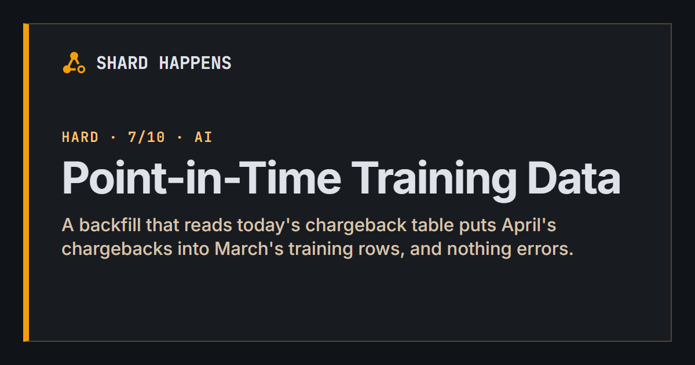

# 56. Point-in-Time Training Data

> A backfill that reads today's chargeback table puts April's chargebacks into March's training rows, and nothing errors.

The Leakage Challenge (Feast). A point-in-time training dataset builder for a fraud model: event time against availability time, as-of joins over append-only feature history, backfilled corrections, reproducible reruns, and detecting data leakage after the fact.

| Level | Score | Data modelling | Scale | Consistency | Real-time | Algorithmic depth |
|---|---|---|---|---|---|---|
| Hard · AI | 7/10 | 5/5 | 4/5 | 3/5 | 1/5 | 3/5 |

The introduction, the difficulty breakdown, the problem framing and the questions are open to everyone. The rest of the page needs premium access.

**[Read it on shardhappens.dev](https://shardhappens.dev/problems/training-dataset/)**

[All problems](../README.md)
