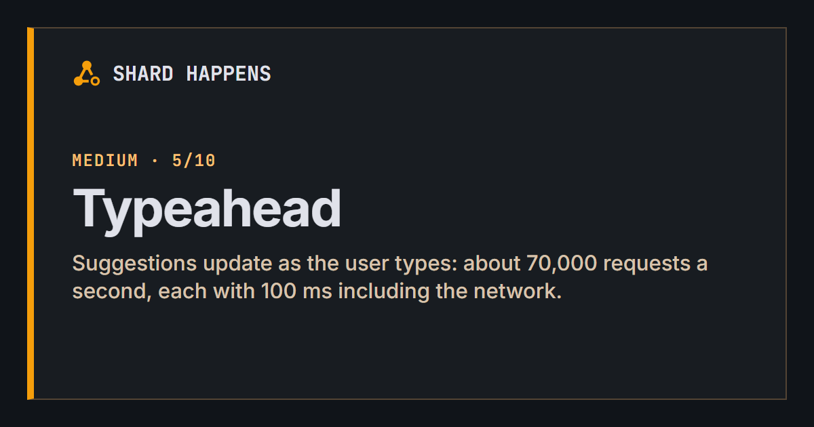

# 12. Typeahead

> Suggestions update as the user types: about 70,000 requests a second, each with 100 ms including the network.

The Latency Challenge (Google search suggestions). Tests data structure choice, precomputation and how much work can be moved away from request time.

| Level | Score | Data modelling | Scale | Consistency | Real-time | Algorithmic depth |
|---|---|---|---|---|---|---|
| Medium | 5/10 | 2/5 | 4/5 | 1/5 | 4/5 | 4/5 |

The introduction, the difficulty breakdown, the problem framing and the questions are open to everyone. The rest of the page needs premium access.

**[Read it on shardhappens.dev](https://shardhappens.dev/problems/typeahead/)**

[All problems](../README.md)
