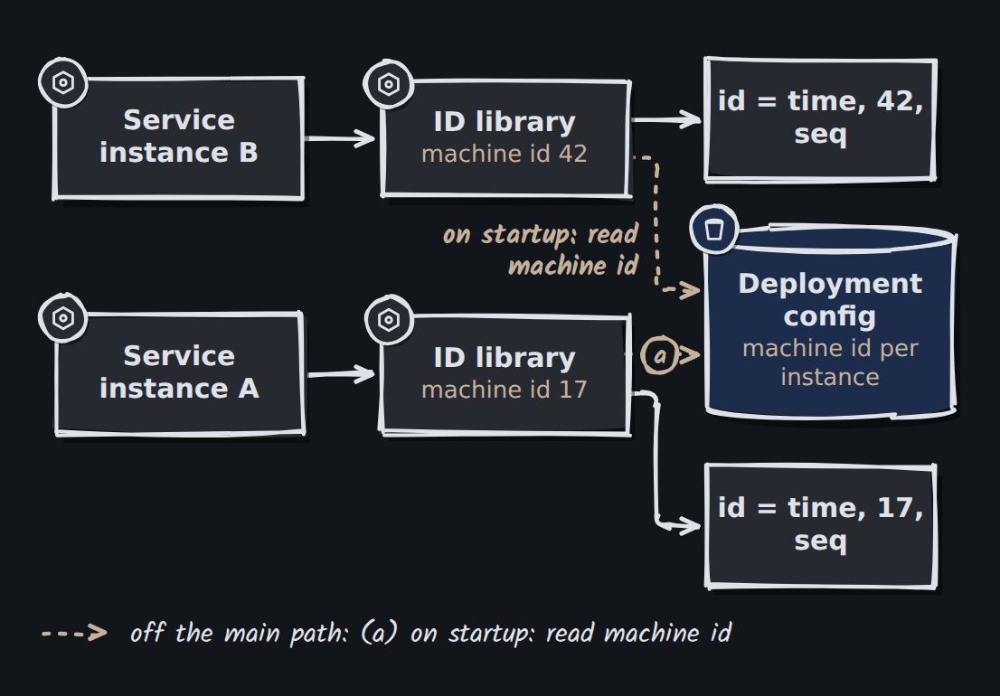

# 9. Unique ID Generator

> Every server hands out ids without asking the others, which works until NTP moves a clock backwards.

The Coordination Challenge (Twitter Snowflake, order and transaction ids). An easy opener: one small component, a handful of clear options, and a quick read on whether the candidate thinks about failure.

| Level | Score | Data modelling | Scale | Consistency | Real-time | Algorithmic depth |
|---|---|---|---|---|---|---|
| Easy | 2/10 | 1/5 | 2/5 | 2/5 | 1/5 | 2/5 |

## What the interviewer looks for

| Green flags | Red flags |
|---|---|
| Asks about size, ordering and volume before proposing | Jumps to UUID or Snowflake without asking |
| Explains what each field is for and can resize the bit split | Recites "41-10-12" without knowing why |
| Raises the backwards-clock problem unprompted | Assumes clocks are always correct |
| Has a concrete way to assign machine ids | "Each server just picks a number" |
| Knows the ordering is approximate across nodes | Claims strict global ordering |

The page is free to read in full: the questions an interviewer asks, the approaches compared, the whole design and the numbers behind it.

**[Read it on shardhappens.dev](https://shardhappens.dev/problems/unique-id-generator/)**

[All problems](../README.md)
