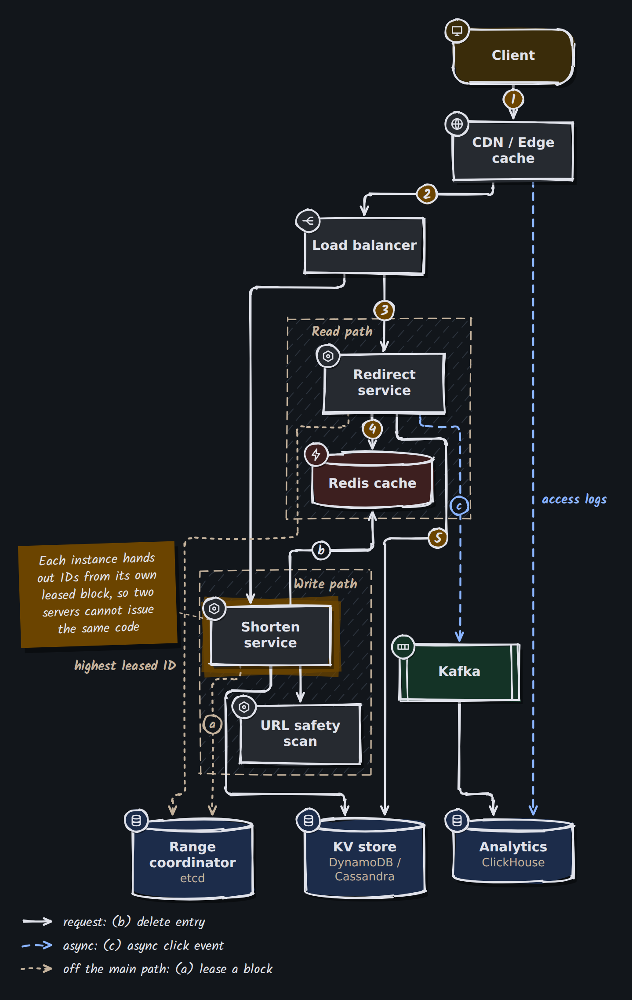

# 1. URL Shortener

> Rated easy. Most of the marks are in what happens when two servers hand out a code in the same millisecond.

The Global Scale Challenge (Bitly, TinyURL). Looks trivial, then gets interesting at uniqueness under concurrency, hot keys and redirect latency.

| Level | Score | Data modelling | Scale | Consistency | Real-time | Algorithmic depth |
|---|---|---|---|---|---|---|
| Easy | 3/10 | 1/5 | 3/5 | 2/5 | 1/5 | 2/5 |

## What the interviewer looks for

| Green flags | Red flags |
|---|---|
| Computes key space and picks code length from it | "Just use MD5" with no collision plan |
| Separates read and write paths and scales them independently | Synchronous analytics write inside the redirect |
| Discusses 301 vs 302 in terms of analytics and takedown | Single auto-increment DB as the ID source |
| Mentions stampede protection for hot keys | Caches everything forever with no invalidation story |
| Raises abuse and enumeration unprompted | Ignores custom alias collisions with generated codes |

The page is free to read in full: the questions an interviewer asks, the approaches compared, the whole design and the numbers behind it.

**[Read it on shardhappens.dev](https://shardhappens.dev/problems/url-shortener/)**

[All problems](../README.md)
