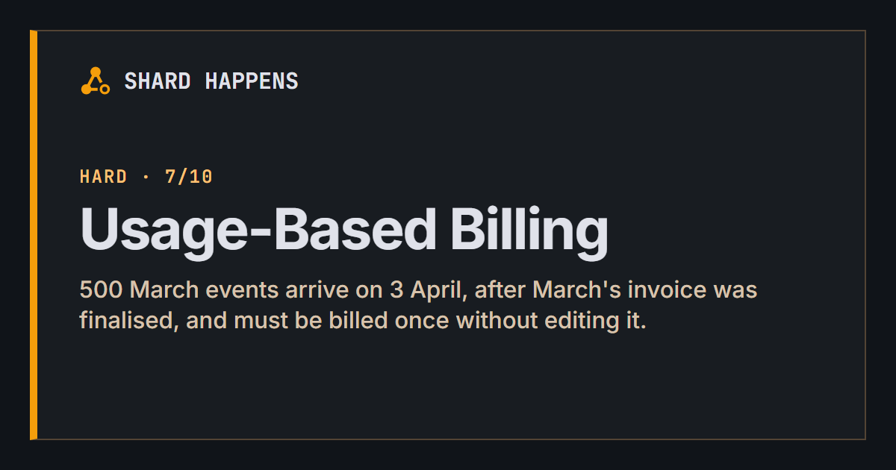

# 49. Usage-Based Billing

> 500 March events arrive on 3 April, after March's invoice was finalised, and must be billed once without editing it.

The Metering Challenge (Stripe Billing meters, usage lines on cloud and API bills). Every usage event counted once into the right customer's right month, when events arrive twice, late or after the invoice has gone out, with every invoice line traceable to its events.

| Level | Score | Data modelling | Scale | Consistency | Real-time | Algorithmic depth |
|---|---|---|---|---|---|---|
| Hard | 7/10 | 4/5 | 3/5 | 4/5 | 2/5 | 2/5 |

The introduction, the difficulty breakdown, the problem framing and the questions are open to everyone. The rest of the page needs premium access.

**[Read it on shardhappens.dev](https://shardhappens.dev/problems/usage-billing/)**

[All problems](../README.md)
