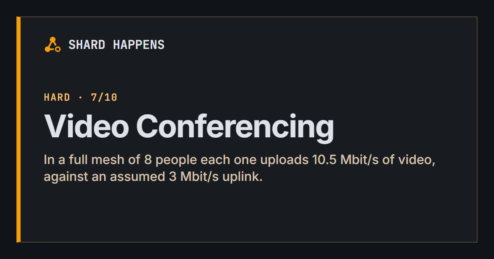

# 39. Video Conferencing

> In a full mesh of 8 people each one uploads 10.5 Mbit/s of video, against an assumed 3 Mbit/s uplink.

The Forwarding Challenge (Zoom, Google Meet). Every participant sends once, and every other participant receives at a quality their own connection can carry, fast enough to hold a conversation.

| Level | Score | Data modelling | Scale | Consistency | Real-time | Algorithmic depth |
|---|---|---|---|---|---|---|
| Hard | 7/10 | 2/5 | 3/5 | 2/5 | 5/5 | 4/5 |

The introduction, the difficulty breakdown, the problem framing and the questions are open to everyone. The rest of the page needs premium access.

**[Read it on shardhappens.dev](https://shardhappens.dev/problems/video-conferencing/)**

[All problems](../README.md)
