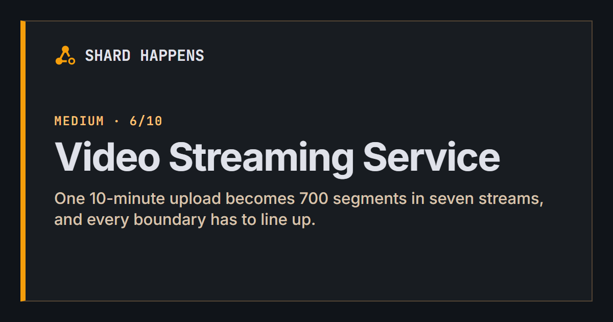

# 36. Video Streaming Service

> One 10-minute upload becomes 700 segments in seven streams, and every boundary has to line up.

The Renditions Challenge (YouTube, Netflix). One upload becomes many renditions cut into aligned segments, and the cost of serving them is storage and egress, not requests.

| Level | Score | Data modelling | Scale | Consistency | Real-time | Algorithmic depth |
|---|---|---|---|---|---|---|
| Medium | 6/10 | 2/5 | 5/5 | 2/5 | 3/5 | 3/5 |

The introduction, the difficulty breakdown, the problem framing and the questions are open to everyone. The rest of the page needs a free account.

**[Read it on shardhappens.dev](https://shardhappens.dev/problems/video-streaming/)**

[All problems](../README.md)
