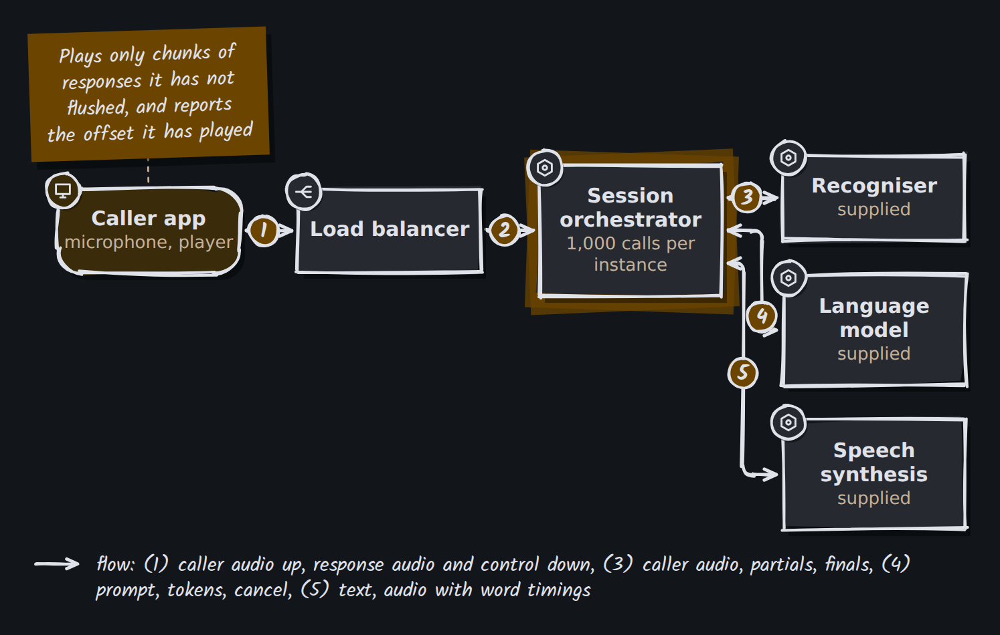

# 76. Real-Time Voice Agent

> The model wrote three sentences and one had played when the caller cut in. The next prompt holds only that one.

The Interruption Challenge (phone support agents, the voice mode of a chat assistant). AI architecture: supplied recognition, language and speech models in one live call, where the caller can cut in at any moment and the conversation history has to match what was actually played.

| Level | Score | Data modelling | Scale | Consistency | Real-time | Algorithmic depth |
|---|---|---|---|---|---|---|
| Hard · AI | 7/10 | 3/5 | 3/5 | 3/5 | 5/5 | 3/5 |

## What the interviewer looks for

| Green flags | Red flags |
|---|---|
| Gives every response an id and drops output for a closed one | Relies on the model or synthesiser stopping when cancelled |
| Commits the history from the player's report of what played | Keeps the full generated text, or what was sent, as what the assistant said |
| Defines played precisely and separates it from sent and heard | Uses "the caller heard" for anything the system can measure |
| Bounds audio sent ahead of playback and flushes the player's buffer | Pushes the whole answer to the player and stops only the synthesiser |
| Pauses on speech and decides on recognised words | Treats every sound as an interruption, or none |
| Builds the next prompt only after the previous response has closed | Starts the next prompt while the previous response is still being committed |

The page is free to read in full: the questions an interviewer asks, the approaches compared, the whole design and the numbers behind it.

**[Read it on shardhappens.dev](https://shardhappens.dev/problems/voice-agent/)**

[All problems](../README.md)
