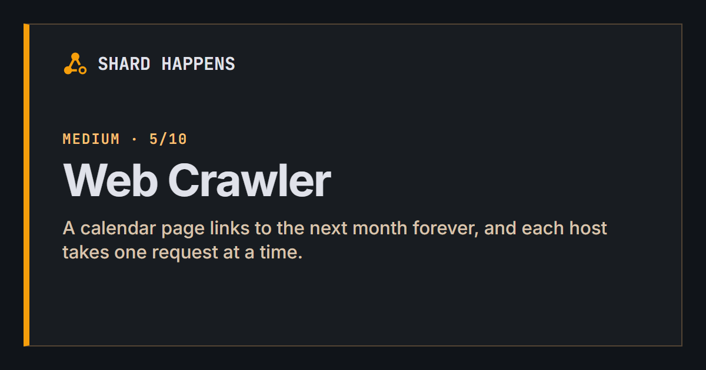

# 16. Web Crawler

> A calendar page links to the next month forever, and each host takes one request at a time.

The Politeness Challenge (Googlebot, Common Crawl, the Internet Archive's Heritrix). A billion pages a month through a URL frontier that can keep 2,000 fetch slots busy, sends each host one request at a time and spends little of the crawl on spider traps or duplicate content.

| Level | Score | Data modelling | Scale | Consistency | Real-time | Algorithmic depth |
|---|---|---|---|---|---|---|
| Medium | 5/10 | 2/5 | 4/5 | 2/5 | 2/5 | 3/5 |

The introduction, the difficulty breakdown, the problem framing and the questions are open to everyone. The rest of the page needs a free account.

**[Read it on shardhappens.dev](https://shardhappens.dev/problems/web-crawler/)**

[All problems](../README.md)
