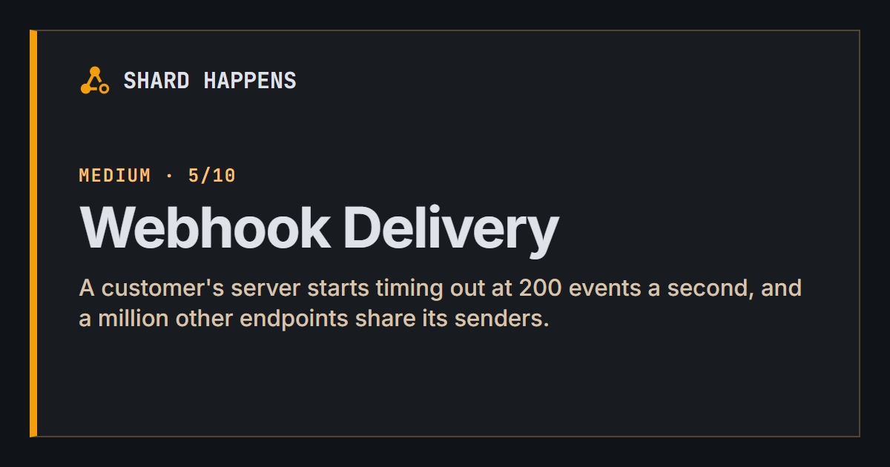

# 42. Webhook Delivery

> A customer's server starts timing out at 200 events a second, and a million other endpoints share its senders.

The Isolation Challenge (Stripe webhooks, GitHub webhooks). Every event reaches every subscribed customer endpoint at least once, with retries, a final give-up, replay and signed payloads, while an endpoint that is slow, failing or down for days delays nobody else.

| Level | Score | Data modelling | Scale | Consistency | Real-time | Algorithmic depth |
|---|---|---|---|---|---|---|
| Medium | 5/10 | 3/5 | 3/5 | 3/5 | 2/5 | 2/5 |

The introduction, the difficulty breakdown, the problem framing and the questions are open to everyone. The rest of the page needs a free account.

**[Read it on shardhappens.dev](https://shardhappens.dev/problems/webhook-delivery/)**

[All problems](../README.md)
